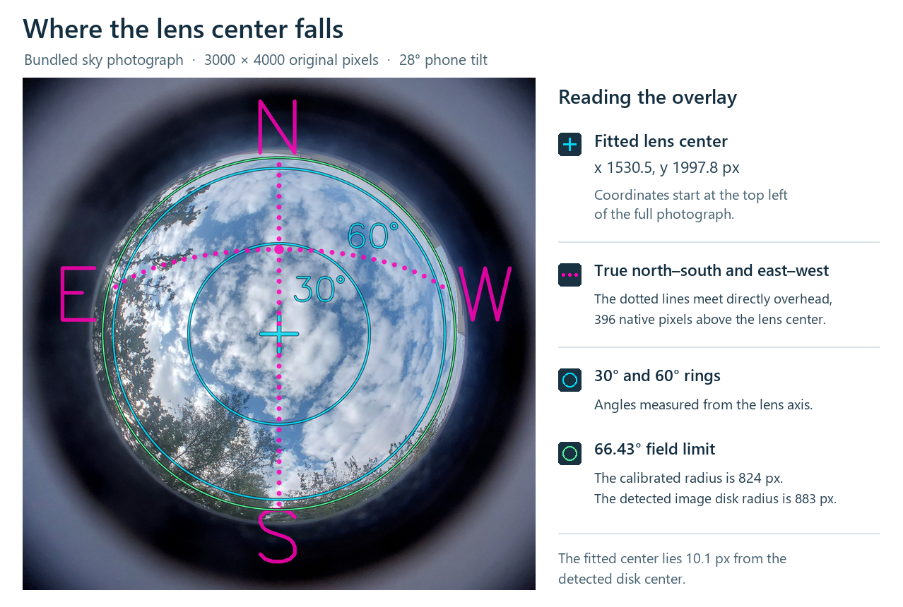

# Calibrated sky grid

**Show sky grid** draws the following guides on the original sky photo. Zoom or expand the preview to inspect them.

| Guide | What it measures |
| --- | --- |
| Cyan cross | The calibrated optical center, where the lens axis reaches the photograph. Hover over **Show sky grid** for the original pixel coordinates. |
| Cyan circles | Angles from the lens axis in 30° steps. The calibration polynomial sets each radius. A tilted phone still has concentric lens rings. |
| Magenta dotted N–S and E–W lines | The visible parts of the true geographic meridians. The larger magenta dot marks straight overhead (zenith) when visible. A tilted or rolled camera can turn these meridians into curves. |
| Green outline | The selected calibrated angular limit. The photo edges and detected image disk can further restrict usable coverage. |

## Reading the bundled photograph

On the oriented 3000 × 4000 photo, the fitted center is **(1530.53, 1997.85) px** measured from the top left. The detected image disk is centered at **(1521.88, 2003.13) px**, about 10 px away. The calibration fits checkerboard observations. Disk detection estimates the visible circular footprint of the lens. Agreement between them is a visual check and cannot establish the true optical axis from this photo alone.

The example lens maps 30° to a radius of 423.23 px and 60° to 776.19 px. The 66.43° half-field ends at 823.94 px. The phone's assigned 28° tilt places true zenith at (1530.53, 1602.06) px, about 396 px above lens center. The magenta axes cross there. [Solar path and camera pose](SOLAR_OVERLAY_CONVENTION.md)

## Geometry and coverage

Rings stay with the calibrated lens. Compass lines use the same camera pose and native projection as shading and the solar path. Each line follows a vertical geographic plane through the visible field, including regions below the horizon when covered. Projection gaps split the dotted traces. N/E/S/W labels identify the visible upper-sky bearings and stay upright. In a level skyward camera with north at the top, east appears on the left.

## Frontend lifecycle

The original-photo viewport and overlay share native image coordinates and one scaling/letterboxing transform, including when the photo preview is downsampled. **Show sky grid** changes only visibility and persists the preference.

Orientation preview work has a separate revision/cancellation lifecycle from time-dependent calculation. Relevant committed edits clear stale markers, debounce and request the newest image/calibration/pose. Old callbacks cannot publish after a newer orientation edit. The image stages can run without irradiance, dates, site or panel inputs; full calculations invoke those stages before weather retrieval.

The library-result cache depends on image identity, effective calibration, native dimensions, actual disk, heading/tilt/roll and library identity. Weather/date/time-zone/panel changes and toggling visibility reuse the overlay. Changing mask settings reruns necessary image preparation; the compass is reused if its actual geometry inputs remain identical.

## Debug Data

`02-orientation` contains:

- `cardinal-directions-overlay.png`: exact transparent library result displayed on the photo.
- `cardinal-directions.xlsx`: the **Cardinal directions** sheet gives the four geographic anchors and their native coordinates. The **Lens grid** sheet records the fitted center, projected zenith and lens-angle radii.
- `cardinal-directions-details.json`: pose, calibrated center, projected zenith, ring radii, coverage, compass anchors and rendering details.

Standalone previews create `orientation-...` runs containing image, calibration and orientation stages. Full calculation runs include the orientation stage alongside existing scientific stages. Cached results are exported into the current run without regenerating their image.

## Grid generation on the bundled photo

In a fresh 3000 × 4000 example evaluation, the library spent 15 ms on geometry, 39 ms drawing the grid and 359 ms encoding its transparent PNG (413 ms total). The preview reuses that image when zooming or toggling the grid. These timings describe one run on the development machine.

## Historical tick-overlay measurements

Six calls using the bundled 3000×4000 photo's effective calibration and detected disk: three at zero pose and three with heading/tilt/roll. The first call includes cold initialization; subsequent calls share the process.

| Measurement | First call | Subsequent calls |
|---|---:|---:|
| Projector construction and overlay PNG generation | 801 ms | 285–319 ms |
| Above plus PNG/XLSX/JSON exports | 917 ms | 292–329 ms |

Measurements exclude image decoding, segmentation, unrelated stage work and weather retrieval. They describe this machine and image, not a hardware-independent guarantee. No solar samples are computed. Evidence and reproducible development harness: `artifacts/cardinal-backend-check`, including `timings.json`, both pose outputs and `independent-verification.json`.

## Historical verification

The shading suite passes 87 tests, including 13 cardinal cases covering analytical cardinal positions, heading/roll, tilt, disk/rectangle clipping, horizon versus coverage endpoints, unavailable directions, alpha, exact exports and cancellation. Independent Python read-back checks PNG dimensions/alpha/color, all four workbook rows, analytical projection from the exported pose/calibration, and boundary exclusion immediately beyond each non-horizon endpoint. `preview-proof.png` records a visual comparison of zero and tilted/rolled poses over the original photo.

All 50 frontend tests and 23 shading-correction regression tests also pass: 160 relevant tests total. Frontend tests include reduced-photo/native-overlay alignment, geometry-only cache identity, standalone preview with invalid study settings, and early publication before weather failure.

The packaged application passes `artifacts/cardinal-verified/smoke-result.json`, `cardinal-ui-result.json`, `sun-path-ui-result.json` and `timezone-result.json`. The actual WPF checks cover preview before Calculate, an invalid camera entry followed by an unrelated edit and recovery, a valid pose edit while latitude is invalid, display-only toggle/persistence, panel/time-zone reuse, exactly one generation after a pose edit, immediate stale clearing, native PNG byte equality and unchanged sun-path behavior. Screenshots include the original photo with and without markers and the full application window.

The first 696-row example retains exactly 149.33192161721075 kWh/m² before shading and 120.82722381119314 kWh/m² after shading.

Independent read-back passes all 13 completed Debug Data runs: nine full calculations and four standalone orientation previews. Two deliberately interrupted preview runs are correctly marked Cancelled. Each full calculation contains nine workbooks, 41,760 selected integration samples, four independently verified cardinal markers and 12 million unchanged binary-mask pixels. Evidence: `artifacts/cardinal-verified/workbook-verification.json`.

## Historical delivery

Updated `Deliverable-rewritten/APPLICATION.exe` and clean `Deliverable.zip`. The native bundled reference run is copied from the verified packaged application's first calculation, including all three new orientation artifacts. The delivery script preserves existing local `Data/settings.json`; the clean ZIP starts with example settings.

The ZIP has 39 files (763,024,575 bytes). All entries pass CRC verification; all 19 reference-run files match the verified source copy, and ZIP/installed executable hashes agree. A fresh extraction passes the portable startup and UI smoke tests, including automatic example loading and the cardinal overlay controls. Evidence: `artifacts/cardinal-verified/package-verification.json` and `artifacts/cardinal-portable-check/smoke-result.json`.

Executable SHA-256: `14DB1B2F99EA338BDF5CF5EBA3A122E0424926FEE0DAC06FF9CB54E60F54A724`.

