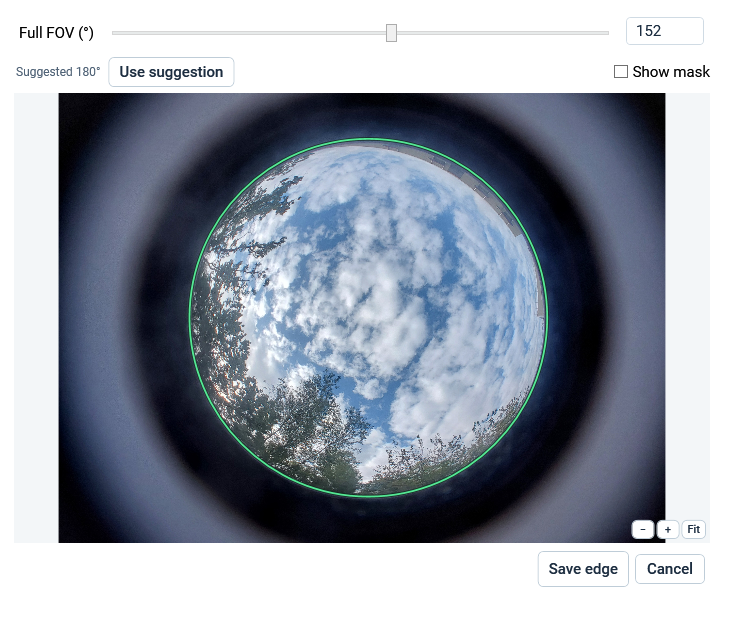

# Refining the sky image edge

SolarShade uses one edge for the sky grid, sun path and shading. The first calculation uses the mask's suggested edge. To adjust it, open **Refine edge…**, move the slider or enter the full FOV, then choose **Save edge**. Run **Update results** to recalculate. Zoom or toggle **Show mask** to align the green circle with the visible rim.

The value spans the full field. A **152°** edge is **76°** from the lens axis. With a usable outward lens fit, you can refine the full field up to **270°**. Parts of the circle beyond the photo are clipped on screen. The calculation still needs an in-frame, observed mask sample for sunlight to reach the panel.

## What the rings measure

Each ring samples 1,440 bearings at the original image resolution, centered on the calibrated lens center. The radius increases by 1 px, or by 2 px for images whose shorter side is at least 1,000 px. The scan also samples the exact 180° endpoint when a complete circle fits in the photograph.

Starting at 180° and working inward, SolarShade finds the beginning of the final band in which every ring has at least **1,368 observed black samples out of 1,440** (95%). Pixels excluded by the photo, lens disk or classifier crop cannot count toward that threshold. When sky reappears, it looks farther out. If the mask cannot establish a terminal band, the proposal is 180°. Calibrations already reaching 180° use their measured range up to the study’s 270° ceiling. Refining the proposal above 180° is a visual adjustment.

Angles outside calibration are estimates. SolarShade continues the slope of the lens’s angle-to-radius curve at the last calibrated angle. For the bundled photograph the polynomial turns inward after 78.79° incident angle, so simply extending that polynomial could assign two angles to one radius. The endpoint slope gives a consistent outward projection. An independently measured direction near the edge would be needed to test its angular accuracy.

In a controlled irradiance test, the Sun passed through a known opening between a 120° calibrated field and a 160° terminal dark band. Applying the extension recovered the expected **0.400 kWh/m²** in that hour. Selecting a fully blocked mask produced **0.000 kWh/m²** with the same weather and panel orientation.

## Bundled photograph

The calibrated field is **132.86° full** at **823.94 px**. The estimated 180° ring lies at **970.36 px**. The automatic mask classifies cloud and sky beyond calibration. At **867.94 px** (147.03° estimated full), it still labels **70 of 1,440** samples as open. A 95%-black crossing at that radius cannot establish a terminal band. Starting at **893.94 px** (155.40° estimated full), all samples on every remaining ring fall outside the mask’s coverage.

The original field trial compared four thresholds. SolarShade uses the 95% column.

| Mask preparation | 100% | 95% | 90% | 80% | Observed at the 180° cap |
| --- | ---: | ---: | ---: | ---: | --- |
| Automatic disk | 180° cap | 180° cap | 180° cap | 180° cap | All 1,440 samples unknown |
| Centered disk | 180° cap | 165.06° | 148.96° | 145.09° | 28 classified open, 1,412 blocked |

The photograph’s visible transition to the housing lies around **880–886 px**. Some pixels farther out on the housing also receive an open-sky label. A black ring can be made by a building or trees, and a classifier can mark a housing reflection as sky. For direct irradiance, an opening matters when the projected Sun passes through it.

On this photograph, that visible rim corresponds to about **151–153° full** under the extrapolated lens model. Try **152°** in the preview. The automatic scan reached 180° because all 1,440 samples at its outer circle fell outside classified coverage. A different image can reach the same cap because white mask pixels are still visible there.

| Bundled 744-hour study | Shaded panel energy |
| --- | ---: |
| Measured 132.86° | 107.3974 kWh/m² |
| Apparent 152° | 109.2394 kWh/m² |
| Automatic 180° cap | 109.2410 kWh/m² |
| Refined 270° | 109.2410 kWh/m² |

All four calculations used the same **131.3587 kWh/m²** of unshaded panel energy. The extra field from 152° to 180° contributed about **0.0016 kWh/m²** on this mask and panel orientation. Extending the circle to 270° added no observed sky on this particular mask.

## Field trial with nominal 235° lenses

We used ten October-audit sky photographs whose oriented dimensions matched their respective calibrations. They cover six site–phone setups, including five views from one setup. Each photo was tested with both automatic disk detection and centered disk preprocessing using the production EfficientNet-B5 model at 1024 input size. Four profiles already measured **183.45° to 186.66° full**, so those four photos required no extension. [Calibration audit](CALIBRATION_AUDIT_2026-11-24.md)

| Result at 100% across the six eligible photos | Automatic disk | Centered disk |
| --- | ---: | ---: |
| Fully dark starting at calibration | 1 | 4 |
| Fully dark band begins beyond calibration | 0 | 1 |
| 180° cap with observed open sky on the final ring | 1 | 1 |
| 180° cap with incomplete coverage and no observed sky on the final ring | 4 | 0 |

The automatic masks showed at least one observed open sample **between calibration and 180°** on three of the six eligible photos. At Site 3, the centered POCO mask yielded a continuous all-black band from **176.59°** through 180°. At the same site the automatic mask supplied **zero observed samples** at 180°. At Site 4, the upper-left automatic mask had one open sample and 976 unknown at the cap. The same centered-mask ring had ten open samples and complete coverage.

The per-photo table gives the estimated limits at every threshold together with the open, blocked and unknown counts at 180°. A blank cap count means no scan was needed. The independent scene-to-housing traces in the last columns are pixel measurements. [Full 22-run results](mask-edge-trial-results.csv)
