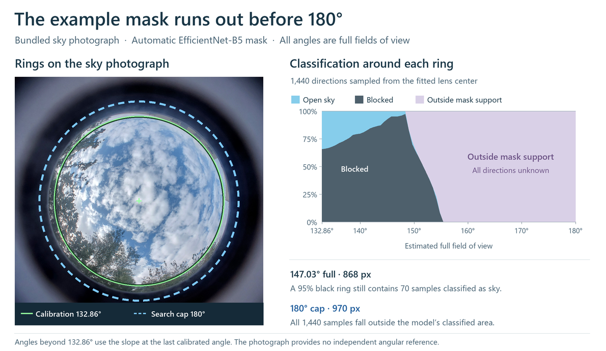

# Searching for open sky beyond calibration

SolarShade can inspect the selected sky mask between the calibrated field of view and **180° full FOV** (90° from the lens axis). The default **100%** setting finds where a completely blocked band begins, provided it continues all the way to 180°. If sky reappears, the scan looks beyond that opening. If the outer ring still contains sky or the photograph or mask runs out, the result is the 180° search cap. The dialog gives the reason. A calibration that already covers 180° or more keeps its measured field.

## Using the result in a study

1. Choose the mask for calculation and open **Estimate edge…** beside the sky photograph. The green circle is the calibrated limit. Blue marks the 180° cap. An amber circle appears where a qualifying dark band starts.
2. Start at **100%**. Try 95%, 90% or 80% to see how accepting gaps changes the result. **Show mask** lets you compare classifications against the photograph. The readout also reports whether the scan found any classified open sky beyond calibration.
3. Choose **Use for calculation** and then **Update results** to apply the selected threshold to the study’s selected mask. The camera profile retains its measured calibration. **Use calibration only** restores the calibrated field on the next update.

**Use full-frame mask…** accepts an opaque, binary PNG at the sky photograph’s oriented dimensions. Supply the original classification with white for open sky and black for blocked directions. A black border baked into a previously cropped PNG can mimic an obstruction. A file opened in this dialog is for inspection. To calculate with it, first import it as the study mask.

## What the rings measure

Each ring samples 1,440 bearings at the original image resolution, centered on the calibrated lens center. The radius increases by 1 px, or by 2 px for images whose shorter side is at least 1,000 px. The scan also samples the exact 180° endpoint when a complete circle fits in the photograph.

Starting at the cap and working inward, SolarShade finds the first radius of the final continuous band that meets the chosen percentage. At 100%, one observed white sample or one unknown sample breaks a band. At 95%, at least 1,368 of the 1,440 samples on **every** ring in the band must be observed black. Pixels excluded by SolarShade’s known disk, AI crop or circular model output count as unknown. A band that is already dark at the calibrated limit needs no extension.

Angles outside calibration are estimates. SolarShade continues the slope of the lens’s angle-to-radius curve at the last calibrated angle. For the bundled photograph the polynomial turns inward after 78.79° incident angle, so simply extending that polynomial could assign two angles to one radius. The endpoint slope gives a consistent outward projection. An independently measured direction near the edge would be needed to test its angular accuracy.

In a controlled irradiance test, the Sun passed through a known opening between a 120° calibrated field and a 160° terminal dark band. Applying the extension recovered the expected **0.400 kWh/m²** in that hour. Selecting a fully blocked mask produced **0.000 kWh/m²** with the same weather and panel orientation.

## Bundled photograph

The calibrated field is **132.86° full** at **823.94 px**. The estimated 180° ring lies at **970.36 px**. The automatic mask classifies cloud and sky beyond calibration. At **867.94 px** (147.03° estimated full), it still labels **70 of 1,440** samples as open. A 95%-black crossing at that radius cannot establish a terminal band. Starting at **893.94 px** (155.40° estimated full), all samples on every remaining ring fall outside the mask’s coverage.

| Mask preparation | 100% | 95% | 90% | 80% | Observed at the 180° cap |
| --- | ---: | ---: | ---: | ---: | --- |
| Automatic disk | 180° cap | 180° cap | 180° cap | 180° cap | All 1,440 samples unknown |
| Centered disk | 180° cap | 165.06° | 148.96° | 145.09° | 28 classified open, 1,412 blocked |

The photograph’s visible transition to the housing lies around **880–886 px**. Some pixels farther out on the housing also receive an open-sky label. A black ring can be made by a building or trees, and a classifier can mark a housing reflection as sky. For direct irradiance, an opening matters when the projected Sun passes through it.

## Field trial with nominal 235° lenses

We used ten October-audit sky photographs whose oriented dimensions matched their respective calibrations. They cover six site–phone setups, including five views from one setup. Each photo was tested with both automatic disk detection and centered disk preprocessing using the production EfficientNet-B5 model at 1024 input size. Four profiles already measured **183.45° to 186.66° full**, so those four photos required no extension. [Calibration audit](CALIBRATION_AUDIT_2026-11-24.md)

| Result at 100% across the six eligible photos | Automatic disk | Centered disk |
| --- | ---: | ---: |
| Fully dark starting at calibration | 1 | 4 |
| Fully dark band begins beyond calibration | 0 | 1 |
| 180° cap with observed open sky on the final ring | 1 | 1 |
| 180° cap with incomplete coverage and no observed sky on the final ring | 4 | 0 |

The automatic masks showed at least one observed open sample **between calibration and 180°** on three of the six eligible photos. At Site 3, the centered POCO mask yielded a continuous all-black band from **176.59°** through 180°. At the same site the automatic mask supplied **zero observed samples** at 180°. At Site 4, the upper-left automatic mask had one open sample and 976 unknown at the cap. The same centered-mask ring had ten open samples and complete coverage.

The per-photo table gives the estimated limits at every threshold together with the open, blocked and unknown counts at 180°. A blank cap count means no scan was needed. The independent scene-to-housing traces in the last columns are pixel measurements. [Full 22-run results](mask-edge-trial-results.csv)
