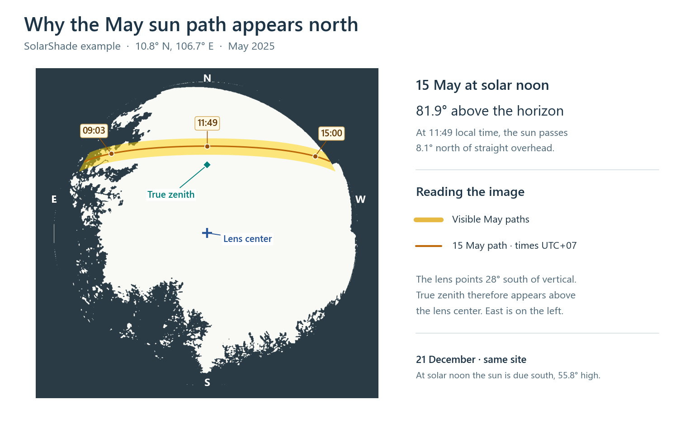

# Which way should the Sun cross the example photo?

The yellow band belongs on the **north** side of the sky in the bundled May 2025 study. The site is at 10.8° N, 106.7° E. On May 15 the Sun was overhead near latitude 18.9° N, so an observer at the site looked due north at solar noon. Six months of seasonal change can move the noon Sun to the other side of the same camera. [NOAA solar geometry](https://gml.noaa.gov/grad/solcalc/solareqns.PDF)

## Reading the angles

| Angle | Zero and positive direction | Bundled example |
| --- | --- | --- |
| Solar bearing | True north is 0°, east 90°, south 180°, west 270° | At noon on May 15, the Sun is due north |
| Solar elevation | Horizon is 0°, directly overhead is 90° | 81.88° at solar noon on May 15 |
| Panel and phone top heading | Lay the device flat. Measure the marked top clockwise from true north. The phone top is the lens end. | Both tops point north, 0° |
| Panel and phone tilt | Start flat at 0° and raise the marked top | Both tops rise 28° |
| Panel-front and lens azimuth | Measure the horizontal direction of the outward normal from south. West is +90°, east is −90°, and north is ±180°. A flat device has no outward azimuth. | Both normals face south, 0° in the equipment convention and 180° as a true bearing |

Boitier specifies the outward azimuth, the tilt from horizontal, and the lens end higher than the bottom. SolarShade adds a **top heading** so a flat device still has an orientation. Its two-angle map assumes the phone top points directly uphill, with both top corners at the same height. A sideways-rolled phone can also have its lens end higher than its bottom. A saved photo with that third angle retains its roll in the projection, and the app identifies the extra roll in the pose controls.

The app projects sunlight into the **phone** frame and calculates panel incidence using the **panel** normal. In the example both devices have the same pose. With a skyward lens, north at the top puts east on the left. The tilted lens points 28° south of overhead. On the oriented 3000 × 4000 photograph, the lens center is at (1530.5, 1997.8), true zenith is at (1530.5, 1602.1), and the May 15 noon Sun is at (1530.5, 1492.3). Pixel rows increase downward.

## Independent checks

| Site and date | Local solar noon | Solar bearing | Elevation |
| --- | --- | --- | ---: |
| Example · May 1, 2025 | 11:50:17 UTC+07 | North | 85.65° |
| Example · May 15, 2025 | 11:49:32 UTC+07 | North | 81.88° |
| Example · May 31, 2025 | 11:50:53 UTC+07 | North | 78.85° |
| Example · December 21, 2025 | 11:51:14 UTC+07 | South | 55.76° |
| Toulouse · May 15, 2025 · 43.6045° N, 1.4442° E | 13:50:34 UTC+02 | South | 65.39° |

The check used the imported workbook's 744 hourly intervals and the saved local timestamps. Solar positions were independently calculated with pvlib 0.15.2's NREL Solar Position Algorithm using sea level, 1013.25 hPa, 12 °C, ΔT of 69.2 s and a refraction setting of 0.5667°. [pvlib SPA reference](https://pvlib-python.readthedocs.io/en/stable/reference/generated/pvlib.solarposition.spa_python.html)

- **Time and sky direction.** Across all 44,640 minute midpoints, the greatest angular separation between the app's geometric solar direction and SPA was below 0.0084°.
- **Camera and mask.** The independent projection used local east–north–up coordinates. Camera right points west, image top is (0, cos 28°, sin 28°), and the lens points along (0, −sin 28°, cos 28°). Applying the bundled lens's incident-angle-to-radius polynomial to the apparent solar directions reproduced every one of the 1,006 exported track vertices to within 0.13 native pixel. Each vertex also landed on the rendered yellow overlay.
- **Panel irradiance.** Multiplying direct normal irradiance by the positive part of the Sun–panel incidence cosine reproduced the exported direct component to within 0.000001 W/m² across all 44,640 substeps.
- **Repeatable checks.** Five regression cases exercise the application's timeline, panel transposition and native overlay with fixed independent expected bearings, elevations and pixel positions. They cover morning, noon, afternoon, a change of season and a change of latitude. [Regression cases](../src/ApplicationFrontend/Tests/SolarOverlayConventionTests.cs)

The example's 28° tilt and north-pointing top are study settings. The photograph has no independent field measurement of its heading and tilt. These checks establish where SolarShade should draw the Sun **for the entered pose**. Confirming its alignment with actual trees or buildings requires the pose used when the photo was taken.
